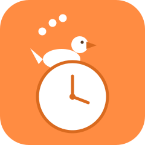
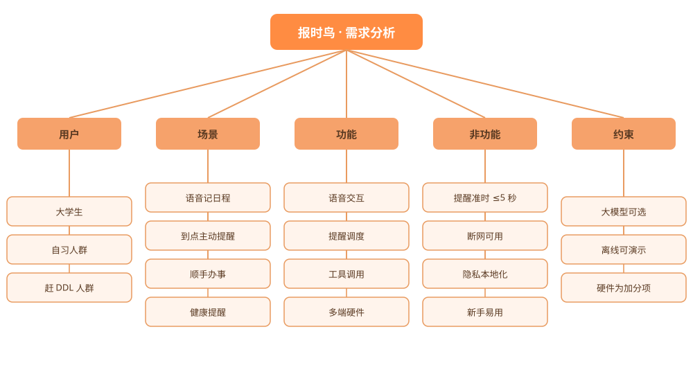
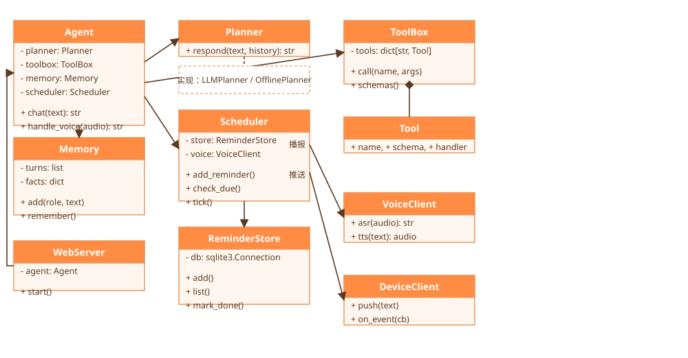

# 报时鸟（DeskBird）需求分析文档

文档状态：第一次作业评审版

版本：v0.6

## 一、引言

### 1.1 编写目的

本文件定义"报时鸟"桌面语音助手的功能与非功能需求，作为后续开发、测试与验收的依据。
最终验收以本文件为准。

### 1.2 项目背景

上一版"办公小助手"证明了智能体"能说会做"的可行性；本版本在其基础上，面向大学生把产品
升级为"桌面常驻、主动提醒"的语音助手。

### 1.3 术语与缩略

| 术语 | 含义 |
| --- | --- |
| ASR | 语音识别（把声音转成文字） |
| TTS | 语音合成（把文字转成声音） |
| 提醒 | 到点由系统主动推送的日程播报 |
| 桌面端 | 运行在电脑上的主界面（网页技术栈打包） |
| 硬件端 | ESP32 桌面音箱（加分项，可独立运行） |

### 1.4 参考资料

- 《计算机软件需求规格说明规范》（GB/T 9385）
- 上一版项目：`../AgentProject`

## 二、迭代记录

| 版本 | 日期 | 修改人 | 内容 |
| --- | --- | --- | --- |
| v0.1 | 2026-10-26 | 邓家俊 | 搭框架：引言、术语、总体描述 |
| v0.2 | 2026-10-27 | 刘浩彬 | 补功能需求与类图 |
| v0.3 | 2026-10-28 | 曲浩宾 | 补验收标准、非功能需求，统一格式 |
| v0.4 | 2026-11-04 | 段旷卓 | 补前端页面与交互梳理 |
| v0.5 | 2026-11-05 | 李彦峰 | 补后端接口与部署方案、核对验收标准 |
| v0.6 | 2026-11-06 | 刘俊宁 | 整理调研数据、校对文档口径 |

## 三、项目标志

标志说明：一只到点报时的鸟 + 时钟 + 话音气泡，三样合一；颜色用暖橙，代表"到点提醒"的温度感。

## 四、总体需求

### 4.1 产品定位

面向大学生的桌面常驻语音助手，核心能力一句话：说一句就记，到点主动提醒，小事顺手完成。

### 4.2 目标用户

- 主要：大学生（赶 DDL、课表碎片化）；
- 次要：有固定日程提醒需求的办公人群。

### 4.3 需求思维导图

### 4.4 典型场景

| 编号 | 场景 | 一句话 |
| --- | --- | --- |
| S1 | 记作业截止 | "提醒我周五 22:00 交软工作业" |
| S2 | 到点提醒 | 到点弹窗 + 语音"该交软工作业啦" |
| S3 | 记临时待办 | "记一下，明天带学生证" |
| S4 | 顺手办事 | "查一下明天的课表 / 算个 (3+5)*2" |
| S5 | 健康提醒 | "每 45 分钟提醒我起来喝水" |
| S6 | 硬件端 | 按一下音箱按钮，说一句，到点亮灯播报 |

## 五、功能需求

> 每条按"功能描述 + 前端 + 后端 + 异常"组织，前端、后端都单独展开。

### 5.1 语音对话（核心形态）

- 功能描述：用户按住说话 / 对着音箱说话，系统识别成文字，交给智能体，再把回复读出来。
- 前端：语音按钮（按住说话、松开结束）、识别中的状态提示、回复文字 + 音频播放。
- 后端：接收音频 → ASR 转文字 → `Agent.chat(text)` → TTS 合成音频 → 返回。
- 异常：识别失败时降级为文字输入；TTS 失败时只显示文字。

### 5.2 文字对话

- 功能描述：延续上一版，多轮对话 + 工具调用；聊天窗显示每次调用了哪个工具。
- 前端：消息流（气泡）、"工具: xxx ✓"动作行、模式标识（在线/离线）。
- 后端：`Agent.chat()`，双规划器（大模型 function calling / 离线规则），最近 20 轮上下文 +
  长期记忆。
- 异常：工具报错时回填给模型 / 规则，转换成一句人话。

### 5.3 日程与提醒（核心功能）

- 功能描述：添加 / 查询 / 完成 / 取消提醒，支持一次性与周期提醒，到点主动播报。
- 前端：
  - 聊天窗：自然语言添加（"提醒我…"）；
  - 日程面板：按时间列出未完成提醒，卡片显示时间、内容、来源、状态；
  - 提醒气泡：到点弹出置顶气泡，提供"已完成 / 10 分钟后再提醒"。
- 后端：
  - 意图解析：从自然语言抽出"时间 + 内容 + 重复规则"（大模型解析，规则兜底）；
  - 调度器：定时扫描到期提醒，触发 TTS 播报 + 弹窗推送；
  - 持久化：SQLite 存提醒，重启不丢。
- 异常：时间无法解析时反问"什么时间？"；到期未确认时按策略重复提醒。

### 5.4 工具调用

- 功能描述：延续上一版 9 个工具，并新增"课表查询"；工具执行受 `workspace/` 等约束。
- 前端：聊天窗展示每次工具调用与结果。
- 后端：`ToolBox.call()`，本地直调或走 MCP 子进程，一份 Schema 三处复用。
- 异常：路径越界、序号越界、表达式非法等一律拒绝并给出原因。

### 5.5 记忆

- 功能描述：短期（最近 20 轮）+ 长期（称呼、常用提醒、偏好，落盘）。
- 前端：设置页展示已记住的事实，支持删除。
- 后端：`Memory.add()` / `remember()`，写盘失败只跳过不影响对话。
- 异常：记忆损坏时清空重建，不阻塞主流程。

### 5.6 多端同步与硬件（加分项）

- 功能描述：桌面端与硬件端（ESP32 音箱）共用一份提醒数据，到点两端都能提醒。
- 前端：绑定硬件端、查看在线状态。
- 后端：`DeviceClient` 通过 MQTT/HTTP 与硬件端通信，推送提醒文案；接收硬件端事件。
- 异常：硬件离线时降级为桌面端提醒，并在界面显示"硬件离线"。

## 六、非功能需求

| 类别 | 要求 |
| --- | --- |
| 性能 | 文字对话首字响应 ≤ 3 秒；提醒触发误差 ≤ 5 秒 |
| 可靠性 | 提醒数据重启不丢；断网时文字/提醒核心功能可用 |
| 安全 | 文件工具限制在 `workspace/`；语音与日程数据默认本地存储 |
| 易用性 | 一个新手不读说明也能用"提醒我…"完成首个提醒 |
| 可维护性 | 加一个新工具只改注册表；语音、调度、硬件各自独立模块 |
| 可移植性 | 核心链路仅依赖 Python 3.7+，可离线演示 |

## 七、系统架构与设计

### 7.1 类图

### 7.2 后端详细设计

模块划分：

| 模块 | 职责 |
| --- | --- |
| `agent_core` | 智能体主体，选规划器、维护记忆 |
| `planner` | 大模型 function calling / 离线规则 |
| `tools` | 工具实现 + 注册表 + Schema |
| `memory` | 多轮记忆 + 长期事实 |
| `scheduler` | 提醒调度：添加、扫描、触发 |
| `voice` | ASR / TTS 封装 |
| `device` | 硬件端通信（MQTT/HTTP） |
| `web` | REST + WebSocket 服务，供前端调用 |

主要接口：

| 接口 | 方法 | 说明 |
| --- | --- | --- |
| `/api/chat` | POST | 文字对话，返回 `{reply, actions}` |
| `/api/voice` | POST | 上传音频，返回 `{text, reply, audio}` |
| `/api/reminders` | GET / POST | 查询 / 新增提醒 |
| `/api/reminders/<id>` | PATCH / DELETE | 完成 / 取消提醒 |
| `/ws/events` | WS | 推送到期提醒、硬件状态 |

### 7.3 前端详细设计

| 页面 | 组成 | 关键交互 |
| --- | --- | --- |
| 主界面 | 聊天窗 + 语音按钮 + 动作行 | 输入 / 按住说话 |
| 日程面板 | 提醒卡片列表 + 新增入口 | 查看 / 完成 / 取消 |
| 提醒气泡 | 置顶弹窗 + 快捷按钮 | 已完成 / 10 分钟后再提醒 |
| 设置 | 音色、提醒渠道、模型开关、记忆管理 | 保存即生效 |

前端通过 REST 做增删改查，通过 WebSocket 接收"到点提醒"等主动推送，断线时自动降级为轮询。

## 八、验收标准

> 验收以可复现为准：给一句指令，能得到下面的结果。

| 编号 | 功能 | 验收标准 |
| --- | --- | --- |
| A1 | 语音记日程 | 说"提醒我周五 22:00 交作业"，日程面板出现该提醒 |
| A2 | 到点提醒 | 到点 5 秒内弹窗 + 语音播报，内容一致 |
| A3 | 再提醒 | 点"10 分钟后再提醒"，10 分钟后再次播报 |
| A4 | 周期提醒 | "每天 21:00 提醒背单词"按天重复，可取消 |
| A5 | 文字对话 | 多轮上下文正确（"北京天气"→"那上海呢"） |
| A6 | 工具调用 | 算数、待办、文件读写结果正确，危险输入被拒绝 |
| A7 | 记忆 | "我叫刘浩彬"后问"我叫什么"能答对，重启后仍在 |
| A8 | 断网可用 | 无 API Key 时，提醒与文字核心功能可用 |
| A9 | 硬件联动 | 硬件端到点亮灯播报；按钮语音能生成一条提醒 |
| A10 | 上线运行 | 桌面端可安装运行；网页端可访问 |

## 九、后续计划（对应下一次作业）

1. 落地代码骨架：在上一版 `AgentProject` 基础上新增 `scheduler` / `voice` / `device`；
2. 先打通"文字 → 提醒 → 到点播报"闭环，再接语音与硬件；
3. 补自动化测试：提醒触发、意图解析、断网降级三个重点先测。
